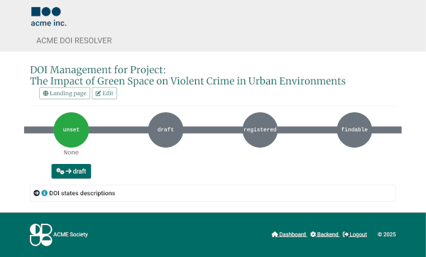

<!--
SPDX-FileCopyrightText: Thomas Breitner

SPDX-License-Identifier: EUPL-1.2
-->

# Onboarding

## TLDR

1. Get access
1. Add or edit a research resource (e.g. a project, a dataset)
1. Publish this record
1. Get a DOI
1. Done

## Interface

RDML provides two interfaces:

1. a public {{ '[*Frontend*]({base_url}/resource/)'.format(base_url=base_url) }} with a listing of resources and *Landing pages* for each resource
1. a non-public, restricted: {{ '[*Backend*]({base_url}/admin)'.format(base_url=base_url) }}

## Roles

| Role | Can |
|------|-----|
| *Curator* | Edit the research resources where they are listed as curator |
| *Administrator* | Add and edit all research resources, persons, organizations; register DOIs |
| *Superuser* | Everything, incl. deleting research resources |

```{note}
*Curators* and *Creators* are different things:

- *Curators*: RDML users who may **edit** a research resource.
- *Creators*: persons (authors) of a research resource. Only metadata, e.g. for the DOI. No login, no permissions.
```

## Get access

1. Be in an allowed network (e.g. via VPN). Allowed IP address ranges: {{ ip_ranges_allowed }}
1. Ask the RDML administrators for access:
    - which role you need
    - which research resources you curate
1. Log in once: {{ '[{base_url}/dashboard/]({base_url}/dashboard/)'.format(base_url=base_url) }}
    - Username: *your-institute-email*
    - Password: *your-institute-password*
1. Tell the RDML administrators that you have logged in. Only then can they add you as a curator.
1. Check the dashboard: *Research resources › N yours* lists your research resources.

## Add or edit a research resource

1. New research resource: ask an RDML administrator to create it. Curators can only edit existing research resources.
1. Missing publisher, organizational unit or person: ask an RDML administrator.
1. Open {{ '[*Backend › Research resources*]({base_url}/admin/research/researchresource/)'.format(base_url=base_url) }}.
1. Required fields:
    - *Title (EN)*
    - *Slug*: short, unique; part of the landing page URL
    - *Publisher*
    - *Organizational unit*
    - *Language*
1. *WORKFLOW*:
    - *Curators*: users who may edit this research resource
    - *Is public*: keep unchecked while editing
    - *DataCite ResourceType*
1. *Creators*: add at least one person. Required for a DOI.
1. Optional sections: descriptions, legal aspects, geographic area, methods, archiving & access, data files description, related resources.
1. Save.
    - URLs are checked for reachability.
    - All changes are logged: *Audit*.

## Publish

1. Check *Is public*.
1. Save.
1. The landing page is now listed in the {{ '[*Frontend*]({base_url}/resource/)'.format(base_url=base_url) }}.

## DOIs

1. Requirements:
    - the research resource is public
    - at least one creator
    - permission to register DOIs (RDML administrators)
1. Research resource › *Register DOI* (or *Update DOI*).
1. DOI states:
    - *draft*: reserved, can be deleted
    - *registered*: resolvable, not indexed
    - *findable*: resolvable and indexed (DataCite Commons)
1. After changing the metadata of a research resource with a DOI: *Update DOI*.

{.bg-warning w=500px align=left}
